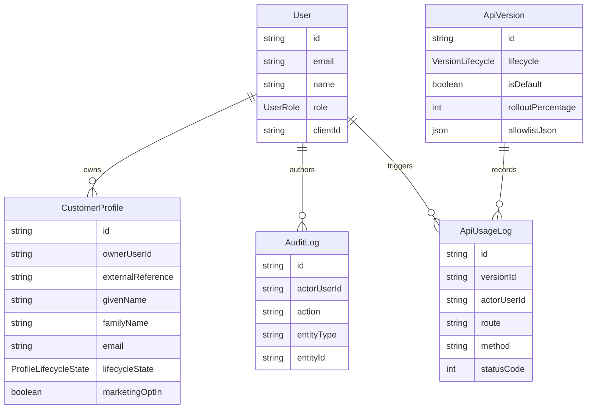

# Domain Model

Entities:
- `User`
  Schema/model: `prisma/schema.prisma` in the `model User` block.
  Primary service owner: `src/services/api-version-service.ts` for operational actions and `src/services/customer-profile-service.ts` for ownership-sensitive profile flows.
- `CustomerProfile`
  Schema/model: `prisma/schema.prisma` in the `model CustomerProfile` block.
  Primary service owner: `src/services/customer-profile-service.ts`.
- `ApiVersion`
  Schema/model: `prisma/schema.prisma` in the `model ApiVersion` block.
  Primary service owner: `src/services/api-version-service.ts`.
- `ApiUsageLog`
  Schema/model: `prisma/schema.prisma` in the `model ApiUsageLog` block.
  Primary service owner: `src/services/api-version-service.ts`, which calls `recordUsage()`.
- `AuditLog`
  Schema/model: `prisma/schema.prisma` in the `model AuditLog` block.
  Primary service owner: both `src/services/customer-profile-service.ts` and `src/services/api-version-service.ts` write through `src/repositories/audit-log-repository.ts`.

Contract note:
- `CustomerProfile` is the canonical storage model. `src/lib/versioning/customer-profile-contracts.ts` derives the `v1` and `v2` API contracts from it rather than storing version-specific tables.

## Version mapping at a glance

The canonical `CustomerProfile` is the only stored shape. Each version is a projection of it:

| Canonical field | v1 | v2 |
|---|---|---|
| `givenName` + `familyName` | `fullName`, joined with a space. Splitting on input puts the first word in `givenName` and the rest in `familyName`, defaulting to `"Unknown"` | `name.givenName`, `name.familyName` |
| `lifecycleState` (`TRIAL`, `ACTIVE`, `SUSPENDED`, `ARCHIVED`) | `status`: `TRIAL`/`ACTIVE` read as `active`, `SUSPENDED`/`ARCHIVED` as `inactive`. On write, `active` becomes `ACTIVE` and `inactive` becomes `SUSPENDED` | `lifecycleState` |
| `marketingOptIn` | not exposed. Create defaults it to `false` | `marketingOptIn` |
| `ownerUserId` | set from the session, never from the body | same |

Source: `src/lib/versioning/customer-profile-contracts.ts:86-197`.

## Lifecycle rule

`assertValidLifecycleTransition` (`src/services/customer-profile-service.ts:24-36`) treats a missing or unchanged state as a no-op. It rejects any change away from `ARCHIVED` with 409. Every other transition is allowed, including `SUSPENDED → TRIAL`.

## Exercise

**Goal:** Predict the stored row after a v1 client creates `{ fullName: "Grace", status: "inactive", ... }`, and what a v2 client then reads.
**Check:** Stored: `givenName: "Grace"`, `familyName: "Unknown"`, `lifecycleState: "SUSPENDED"`, `marketingOptIn: false`. A v2 read returns `name: { givenName: "Grace", familyName: "Unknown" }`, `lifecycleState: "SUSPENDED"`, `marketingOptIn: false`.
