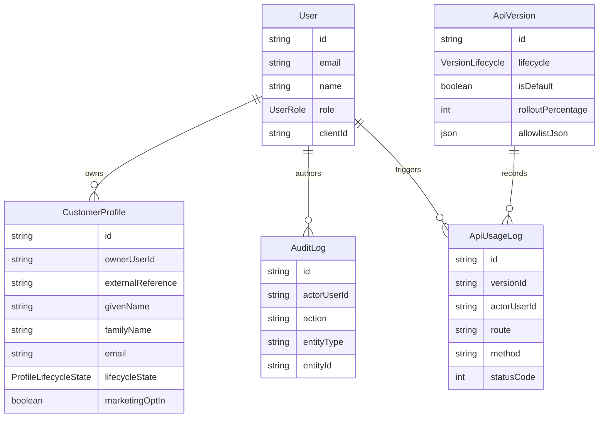

# Domain Model

Entities:
- `User`
  Schema/model: `prisma/schema.prisma` in the `model User` block.
  Primary service owner: `src/services/api-version-service.ts` for operational actions and `src/services/customer-profile-service.ts` for ownership-sensitive profile flows.
- `CustomerProfile`
  Schema/model: `prisma/schema.prisma` in the `model CustomerProfile` block.
  Primary service owner: `src/services/customer-profile-service.ts`.
- `ApiVersion`
  Schema/model: `prisma/schema.prisma` in the `model ApiVersion` block.
  Primary service owner: `src/services/api-version-service.ts`.
- `ApiUsageLog`
  Schema/model: `prisma/schema.prisma` in the `model ApiUsageLog` block.
  Primary service owner: `src/services/api-version-service.ts`, which calls `recordUsage()`.
- `AuditLog`
  Schema/model: `prisma/schema.prisma` in the `model AuditLog` block.
  Primary service owner: both `src/services/customer-profile-service.ts` and `src/services/api-version-service.ts` write through `src/repositories/audit-log-repository.ts`.

Contract note:
- `CustomerProfile` is the canonical storage model. `src/lib/versioning/customer-profile-contracts.ts` derives the `v1` and `v2` API contracts from it rather than storing version-specific tables.
